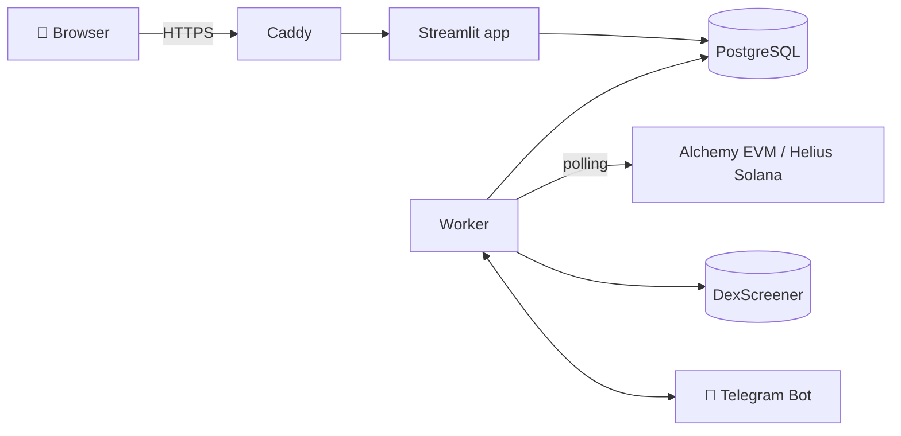

<div align="center">

# 🏹 trackerarrow

**Lacak smart money. Petakan relasinya. Dapat alert sebelum yang lain.**

Wallet tracker multi-user untuk **EVM & Solana**: winrate otomatis, graf relasi antar wallet, dan notifikasi Telegram real-time.


</div>

> 🚧 **Status: MVP.** Sudah jalan: login + peran owner, wallet & list, lama tracking, graf relasi, polling EVM (Alchemy) & Solana (Helius), alert Telegram, halaman Settings & Admin.
> Belum: winrate & aset otomatis, webhook real-time (rencana v0.2). Sampai saat itu wallet tampil sebagai 🆕 Unranked. Spesifikasi lengkap: [REQUIREMENTS.md](REQUIREMENTS.md).

---

## ✨ Fitur

- 👛 **Wallet tracking EVM & Solana**: Ethereum, Base, BNB Chain, Arbitrum, Robinhood, dan Solana.
- 🎯 **Winrate otomatis**: dihitung dari swap on-chain (FIFO, jendela 30 hari), lalu dikelompokkan ke 5 tingkat.
- 🐋 **Kategori aset otomatis**: dari total nilai portofolio wallet, dikelompokkan ke 4 tingkat.
- 📋 **List pribadi**: kelompokkan wallet ke list dengan nama sendiri, misalnya `KOL Solana` atau `Insider Base`.
- ⏱️ **Lama tracking**: lihat sudah berapa lama sebuah wallet ditrack, dan perubahan asetnya sejak saat itu.
- 🕸️ **Graf relasi**: hubungkan wallet (Funding, Same Owner, Copy Trader, …) dalam graf interaktif yang ringan.
- 📣 **Alert Telegram**: setiap BUY/SELL langsung dikirim ke Telegram masing-masing user.
- 👥 **Multi-user**: data label, list, dan relasi tiap user bersifat privat. Halaman Settings dan Admin hanya untuk owner.

---

## 🏷️ Kategori

### Winrate

| | Kategori | Winrate default |
|---|---|---|
| ⚡ | Split Arrow | ≥ 85% |
| 🎯 | Bullseye | 75–84% |
| 🏹 | Sharpshooter | 60–74% |
| 🪶 | Archer | 45–59% |
| 🍂 | Stray Arrow | < 45% |
| 🆕 | Unranked | trade belum cukup |

### Aset

| | Kategori | Total aset default |
|---|---|---|
| 🐋 | Whale | ≥ $1M |
| 🦈 | Shark | $100K – $1M |
| 🐬 | Dolphin | $10K – $100K |
| 🐟 | Shrimp | < $10K |

Semua batas angka bisa diubah owner di halaman **⚙️ Settings**.

---

## 📣 Contoh Alert

```
        📣 WALLET TRACKER ALERT 🔭

🪙 STOXPREPS | STOX (🐦 Robinhood)
0xb4d3a6097b765d094c0950ac03e917a2773eef4d

🎯 Target: 📂 @the wallet (0x96eb...1a5c) (https://robin.etherscan.io/address/0x96eb6b1b30ce315ff1acf21e4f29318a93cf1a5c)
📁 Wallet Track
📉 Action: SELL
💰 Amount: 285.51$
📊 Mcap: $21,325
```

---

## 🏗️ Arsitektur



| Service | Tugas |
|---|---|
| `app` | UI Streamlit, login (`st.login`), halaman user & owner |
| `worker` | Polling transaksi, fan-out alert per user, kirim Telegram, bot `/start` |
| `db` | PostgreSQL 16 |
| `caddy` | Reverse proxy + HTTPS otomatis |

Webhook real-time (FastAPI) menyusul di v0.2.

---

## 🚀 Quick Start (VPS)

> Kebutuhan: VPS dengan minimal 2 vCPU / 4 GB RAM, Docker + Docker Compose, dan domain yang mengarah ke IP VPS.

```bash
git clone https://github.com/<username>/trackerarrow.git
```

```bash
cd trackerarrow
```

```bash
cp .env.example .env
```

```bash
cp .streamlit/secrets.toml.example .streamlit/secrets.toml
```

Isi `.env` (lihat tabel di bawah) dan `.streamlit/secrets.toml` (OAuth Google, redirect URI `https://<domain-anda>/oauth2callback`), lalu jalankan:

```bash
docker compose up -d --build
```

Tabel database dibuat otomatis saat pertama kali jalan. Buka `https://<domain-anda>` dan login memakai email yang ada di `OWNER_EMAIL`. Akun itu otomatis menjadi **owner**.

Backup harian: pasang [scripts/backup.sh](scripts/backup.sh) di crontab VPS.

📘 **Panduan lengkap langkah demi langkah dari VPS kosong:** [DEPLOY.md](DEPLOY.md)

### Development lokal (Windows / Mac / Linux)

Tanpa Docker, memakai SQLite. Buat `.env` berisi `AUTH_MODE=dev` dan `OWNER_EMAIL=<email-anda>` agar bisa login tanpa Google. **Jangan pakai `AUTH_MODE=dev` di VPS.**

```bash
python -m venv .venv
```

```bash
.venv/Scripts/pip install -r requirements-dev.txt
```

```bash
.venv/Scripts/streamlit run app/main.py
```

Di terminal kedua, jalankan worker:

```bash
.venv/Scripts/python -m worker.main
```

Tes otomatis:

```bash
.venv/Scripts/python -m pytest
```

(Di Mac/Linux, ganti `.venv/Scripts/` dengan `.venv/bin/`.)

---

## 🔐 Environment Variables

| Variable | Keterangan |
|---|---|
| `OWNER_EMAIL` | Email akun owner (akses Settings & Admin) |
| `AUTH_MODE` | `oidc` (Google, untuk VPS) atau `dev` (lokal saja) |
| `DATABASE_URL` | Kosong = SQLite lokal. Docker Compose mengisinya ke PostgreSQL |
| `POSTGRES_PASSWORD` | Password PostgreSQL di Docker Compose |
| `APP_DOMAIN` | Domain publik, dipakai Caddy untuk HTTPS |
| `TELEGRAM_BOT_TOKEN` | Token dari [@BotFather](https://t.me/BotFather) |
| `ALCHEMY_API_KEY` | Data transaksi semua chain EVM (Ethereum, Base, BNB, Arbitrum, Robinhood) |
| `HELIUS_API_KEY` | Data transaksi Solana |
| `ETHERSCAN_API_KEY` | *(opsional, belum dipakai di MVP)* |

Konfigurasi login OIDC (Google) disimpan di `.streamlit/secrets.toml` sesuai [dokumentasi Streamlit](https://docs.streamlit.io/develop/concepts/connections/authentication).

---

## 🤖 Menghubungkan Telegram

1. Buka **👤 Profil**, lalu klik **Hubungkan Telegram**.
2. Klik link bot yang muncul, lalu tekan **Start**.
3. Selesai. Alert untuk wallet di list kamu akan dikirim ke chat tersebut.

| Perintah | Fungsi |
|---|---|
| `/start` | Menghubungkan akun |
| `/stop` | Memutuskan akun |
| `/lists` | Melihat list & status notifikasi |
| `/status` | Cek koneksi |

---

## 📁 Struktur Proyek

```
trackerarrow/
├── app/
│   ├── main.py             # titik masuk Streamlit, login, navigasi per peran
│   ├── ui.py               # helper UI (cek owner, flash message)
│   └── views/              # dashboard, wallets, lists, relations, alerts, profile, settings, admin
├── core/
│   ├── config.py           # baca .env
│   ├── db.py, models.py    # SQLAlchemy + daftar chain default
│   ├── services.py         # logika wallet, list, relasi, user
│   ├── categories.py       # kategori winrate & aset
│   ├── template.py         # template WALLET TRACKER ALERT
│   ├── fmt.py              # format alamat, lama tracking, angka
│   ├── dexscreener.py      # harga & mcap
│   └── telegram.py         # klien Bot API
├── worker/
│   ├── main.py             # loop polling + kirim alert
│   ├── evm.py, solana.py   # deteksi BUY/SELL/TRANSFER
│   ├── dispatch.py         # simpan transaksi, fan-out alert per user
│   └── bot.py              # /start /stop /status /lists
├── tests/                  # pytest
├── scripts/backup.sh
├── docker-compose.yml, Dockerfile, Caddyfile
├── .env.example, .streamlit/secrets.toml.example
├── requirements.txt, requirements-dev.txt
├── REQUIREMENTS.md
└── README.md
```

---

## 🗺️ Roadmap

- [x] **MVP**: login + peran owner, wallet & list, lama tracking, graf relasi, polling EVM + Solana, alert Telegram
- [ ] **v0.2**: webhook real-time, winrate & aset otomatis, multi-chain EVM, import/export, kuota user
- [ ] **v0.3**: deteksi relasi otomatis (sumber funding), statistik sejak ditrack, broadcast admin

---

## ⚠️ Disclaimer

trackerarrow hanya menampilkan data on-chain publik untuk tujuan informasi, **bukan saran finansial**. Aplikasi ini bersifat read-only dan **tidak pernah** meminta private key atau seed phrase.

## 📄 Lisensi

Belum ditentukan.
